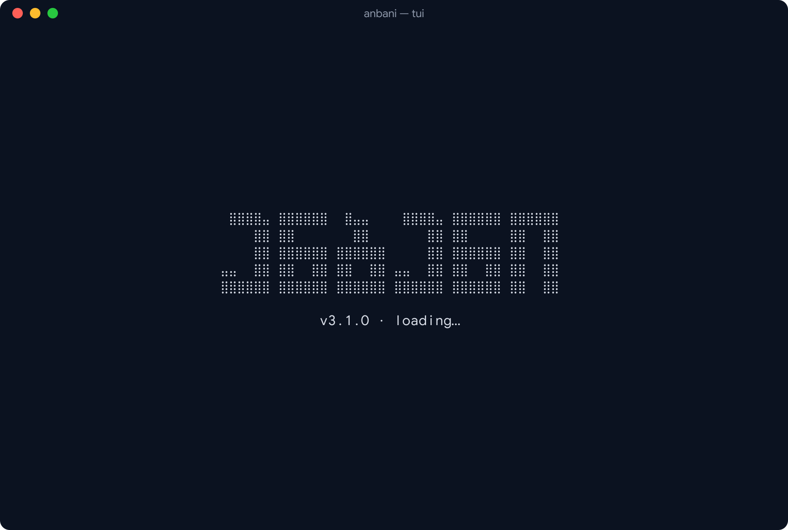
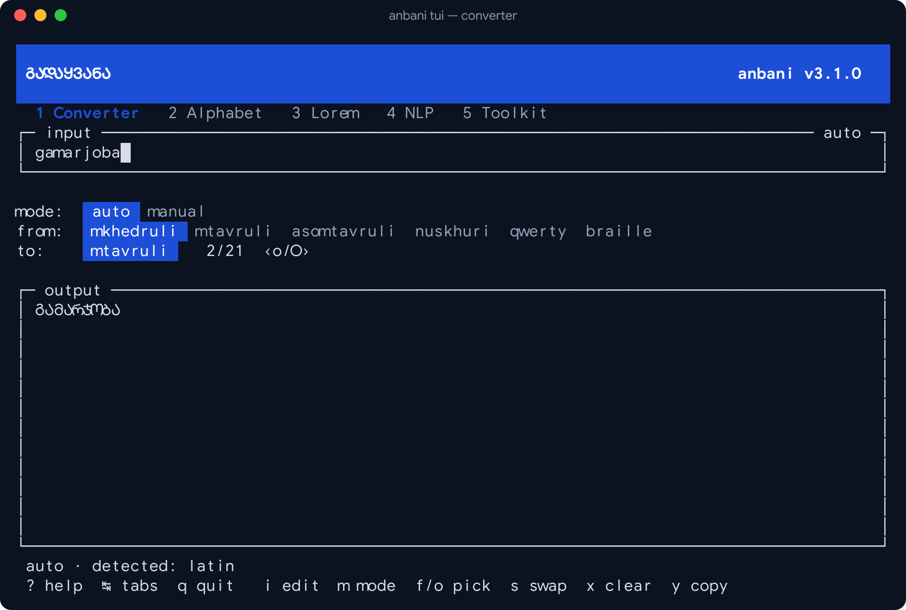
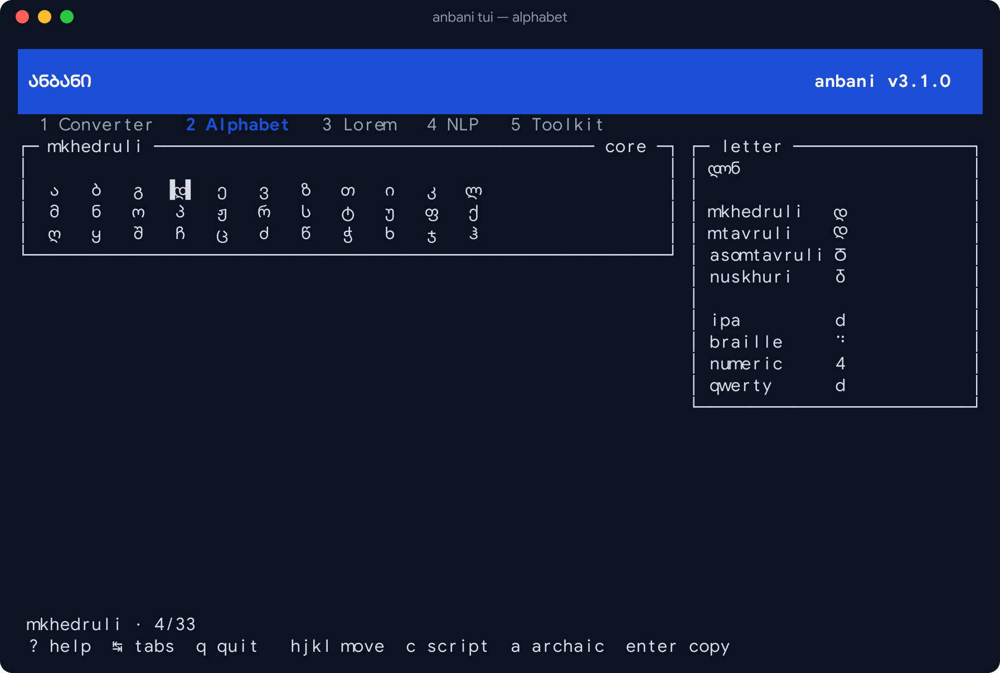
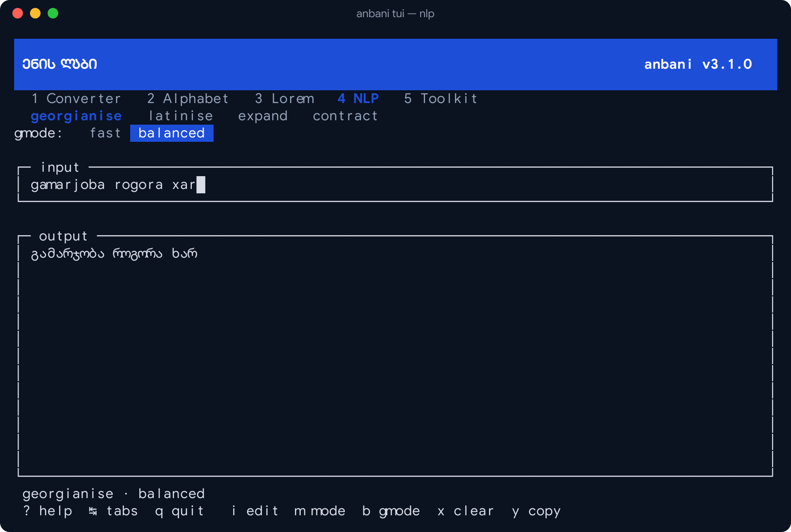
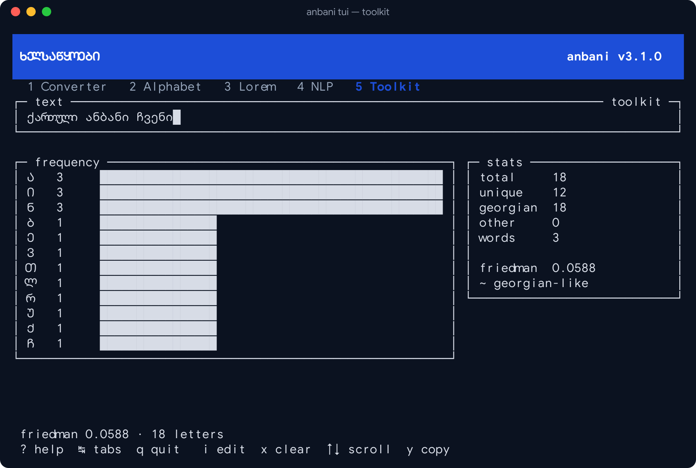

# AnbaniPy

[](https://github.com/Anbani/anbani/actions/workflows/ci.yml)
[](https://pypi.org/project/anbani/)
[](https://pypi.org/project/anbani/)
[](LICENSE)

Georgian Python toolkit for NLP, Transliteration and more. An independent pure-Python package in the [Anbani monorepo](https://github.com/Anbani/anbani/tree/main/packages/py/anbani).

## Install

```bash
pip install anbani
```

Transliteration and NLP utilities use only the Python standard library. PDF / e-book extraction
(`anbani.nlp.utils.ebook2text`) additionally requires PyMuPDF:

```bash
pip install anbani[pdf]
```

## Build from source

The source lives in `packages/py/anbani` in the monorepo. This directory can also be
copied out and built on its own; its checked-in data and fixture snapshots are complete.

From this package directory, install development extras with `python -m pip install -e '.[pdf,dev]'`.
To build a wheel and source archive, install `build` in your development environment and run
`python -m build` (or invoke `scripts/build.sh` from any directory).
Alphabet JSON and both ambigram CSV tables are included locally; building or installing this
package does not require the monorepo generators, another package, or Rust.
The source archive includes the tests and shared fixture snapshot. LICENSE and NOTICE accompany
the distributions.

## Quickstart

Transliteration example:

```python
from anbani.core.converter import convert, interpret

interpret("გამარჯობა", "asomtavruli")

# 'ႢႠႫႠႰႿႭႡႠ'
```

Georgianisation example:

```python
from anbani.nlp.georgianisation import georgianise

georgianise("gamarjoba - rogor xar - rasa iqm - kaia kata - kai erti")

# 'გამარჯობა - როგორ ხარ - რასა იქმ - კაია კატა - კაი ერთი'
```


Convert ebooks with qwerty encoding to unicode Mkhedruli:

```python
from anbani.nlp.utils import ebook2text
from anbani.core.converter import classify_text
from anbani.core.converter import convert

text = ebook2text("books/ჩარლზ დიკენსი - დევიდ კოპერფილდი.pdf")
print(text[:300])

print(classify_text(text))

print(convert(text, "qwerty", "mkhedruli")[:300])

# Bicameral targets capitalise sentence starts (not after abbreviations like ქ. or გვ.);
# verse=True also capitalises every line.
convert("იყო არაბეთს როსტევან,\nმეფე ღმრთისაგან სვიანი", "mkhedruli", "shanidziseuli", verse=True)
# 'Ⴈყო არაბეთს როსტევან,\nႫეფე ღმრთისაგან სვიანი'

# Carlz dikensi daviT koperfildi Tavi pirveli dabadeba me viqnebi gmiri Cemive sakuTari Tavgadasavlisa Tu sxva...

# latin

# ჩარლზ დიკენსი დავით კოპერფილდი თავი პირველი დაბადება მე ვიქნები გმირი ჩემივე საკუთარი თავგადასავლისა თუ სხვა...
```

Expand contractions:

```python
from anbani.nlp.contractions import expand_text

text = "ილია ჭავჭავაძე (დ. 8 ნოემბერი, 1837, სოფელი ყვარელი — გ. 12 სექტემბერი, 1907, წიწამური)"

print(text)
print(expand_text(text))

# ილია ჭავჭავაძე (დ. 8 ნოემბერი, 1837, სოფელი ყვარელი — გ. 12 სექტემბერი, 1907, წიწამური)
# ილია ჭავჭავაძე (დაბადება 8 ნოემბერი, 1837, სოფელი ყვარელი — გარდაცვალება 12 სექტემბერი, 1907, წიწამური)

```

Contract them back:

```python
from anbani.nlp.contractions import contract_text

print(contract_text("მასის ატომური ერთეული და ასე შემდეგ"))

# მ.ა.ე. და ა.შ.
```

## Text statistics & lorem

```python
from anbani import toolkit, lorem

toolkit.frequency("ანბანი")   # per-letter frequencies
toolkit.friedman(text)         # index of coincidence
lorem.sentences(12)            # fake Georgian prose
lorem.names(3)                 # fake full names
```

## Command line

Installing the package also installs an `anbani` command:

```bash
anbani interpret "gamarjoba"                      # -> ᲒᲐᲛᲐᲠᲯᲝᲑᲐ
anbani convert "ანბანი" -f mkhedruli -t asomtavruli
anbani georgianise "gamarjoba"
anbani expand "ვნახოთ ა. შ."
anbani lorem -w 8
```

## Interactive TUI

New in 3.1: a full-screen terminal UI. Launch it with `anbani tui` (or
`python -m anbani tui`). Zero extra dependencies — it is hand-rolled ANSI, and
imports stay lazy so `import anbani` and the plain CLI are unaffected.

```bash
anbani tui
```



Five tabs, switch with `1`–`5` or `tab` / `shift+tab`:

| Tab | What it does |
|-----|--------------|
| **Converter** | live transliteration; `m` toggles auto/manual, `f`/`o` pick source/target, `s` swaps |
| **Alphabet** | letter grid + detail card; `hjkl` to move, `c` cycles script, `a` toggles archaic, `enter` copies |
| **Lorem** | fake Georgian text; `k` kind, `+`/`-` amount, `g` generate |
| **NLP** | georgianise / latinise / expand / contract; `m` mode, `b` georgianise level (fast/balanced/accurate) |
| **Toolkit** | letter-frequency bars + Friedman index of coincidence |

**Converter** — live transliteration with script auto-detection:



**Alphabet** — grid + per-letter detail across every Georgian script, IPA, braille, numeral:



**NLP** — georgianise / latinise / expand / contract:



**Toolkit** — letter-frequency bars and the Friedman index of coincidence:



Global keys: `?` help overlay · `i`/`enter` edit · `y` copy (via OSC 52) ·
`q` or `ctrl+c` quit. Minimum terminal size is 60×16.

Notes:
- No Georgian keyboard? Pick `from: qwerty` in the Converter (type Latin, get
  Georgian), or paste — bracketed paste is supported in edit mode.
- Copy uses OSC 52; some terminals block it, in which case the copy silently does
  nothing.
- Not supported on native Windows (needs a POSIX terminal); use WSL or the npm
  package there.

## Parity with anbani.js

anbani.py and [anbani.js](https://github.com/Anbani/anbani.js) share one
behavior contract, proved in CI by byte-identical package-local `spec/golden.json` snapshots
generated from `common/spec/golden.json`. As of 3.0 they are feature-equivalent; the only
intentional gaps are `ebook2text` (Python-only, needs PyMuPDF) and the
browser/UMD bundle (js-only).

## Kartvelian Morse (proposed)

The same codec as anbani.js `morse`, from the same layout (`common/data/scripts/morse.json`):

```python
from anbani import morse
import anbani

morse.encode("ანბანი აბგ")                     # '.- -. -... .- -. .. / .- -... --.'
morse.decode(".- -. -... .- -. ..")            # 'ანბანი'
morse.encode("ç̌p̌", profile="laz_latin")       # Laz Latin letters read as Mkhedruli
anbani.convert("ანბანი", "mkhedruli", "kartvelian_morse")
```

Characters without a direct code travel as `-------` plus seven decimal digit tokens, so any
string round-trips exactly. Tokens may be separated by any whitespace JavaScript's `\s` accepts.
`classify_text` and `interpret` never detect Morse as a source.

## 4.0
The unified monorepo release. anbani.js, anbani.py and anbani.rs now share MAJOR.MINOR: a 4.0.x of any of them has the same features and passes the same shared golden vectors (`common/spec/golden.json`); PATCH moves per language. Versions come from `common/versions.json`. New here: Kartvelian Morse (`anbani.morse`, `kartvelian_morse`). See the [changelog](https://github.com/Anbani/anbani/blob/main/common/docs/CHANGELOG.md).

## 3.4
Table fixes, each backed by a source in [docs/table-sources.md](docs/table-sources.md).
- New `national_simplified`: the apostrophe-free national system (State Language Department guidelines).
- Letters with no counterpart in the target table are **kept**, no longer dropped (ჶ–ჿ in Asomtavruli/Nuskhuri, ჱ–ჵ in the 33-letter Latin tables).
- Asomtavruli Ⴧ Ⴭ and Nuskhuri ⴧ ⴭ (YN, AEN) added, converted and detected.
- `cyrillic`: ფ п, წ ц, ჭ ч (GUGK 1972). `greek`: ფ π, ხ χ, გ γκ, ი ι, ძ τζ, heta dropped from შ ყ ჭ. `armenian`: ყ ղ.
- `phonetic`: ejectives all ʼ (U+02BC), ჱ ej, ჽ æ, ჼ a bare combining tilde. `iso_9984` (the 1996 edition): ჴ ẖ. `titus`: ძ ʒ. `bgn` (1981): no archaic letters.
- `classify_text` reports `"braille"` and `interpret` accepts braille input.
- `georgianise`: hyphenated words no longer keep their `<…>` markers.
- New `toolkit.numeric_value(text)`: the sum of the letters' numeral values (ჩქ → 1600); the `numeric` target still writes each letter's value.

## 3.0 — breaking changes

- `classify_text` returns `"unknown"` for undetectable / mixed-script text and
  now reports the four bicameral scripts; `interpret` raises on `"unknown"`.
- `convert` / `interpret` raise `ValueError` on an unsupported source or target
  (was an assertion, or a silent passthrough for targets).
- `georgianise` defaults to `mode="balanced"` (was `"accurate"`).

## To-Do

Feel free to fork this repo!  

- [x] Tokenizer
- [x] Transliteration
- [x] Expand contractions
- [x] ebook2text converter
- [ ] Stemmer
- [ ] Lemmatizer
- [ ] Stopwords


## Resources used

- http://www.nplg.gov.ge/civil/statiebi/wignebi/qartul_enis_marTlwera/qartul_enis_marTlwera_tavi-12.htm
- http://www.nplg.gov.ge/civil/upload/Semokleba.htm
